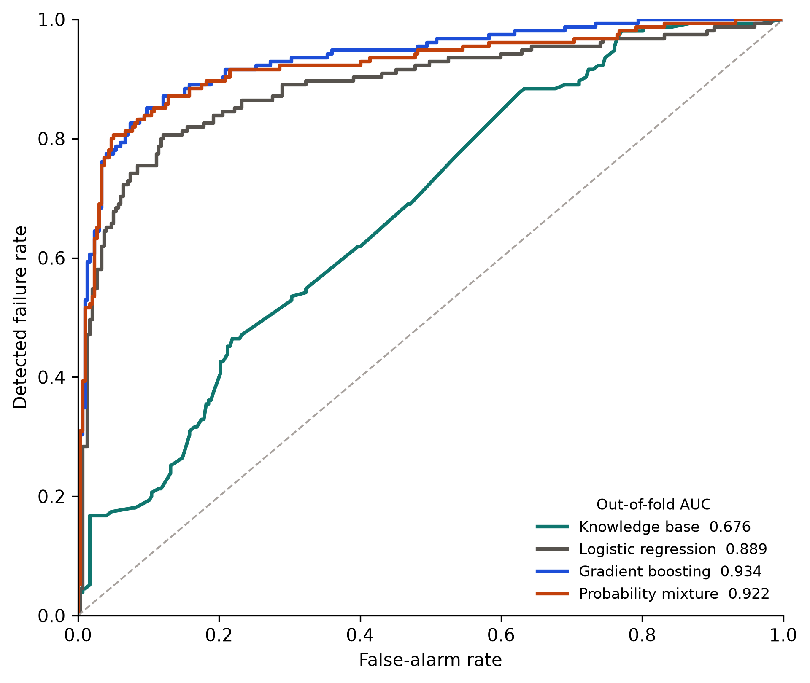

# A knowledge-based early-warning system using artificial intelligence on venture data to predict digital-transformation failure in entrepreneurial firms

**Authors and affiliations.** To be added by the submitting authors.

## Abstract

Founders and investors can see that a digital venture is fragile and still not know which fact should drive the next decision. This short communication builds an early-warning card with two outputs: a failure probability from gradient boosting, and a reason from nine knowledge-base rules covering capability, team, capital, traction, and innovation. The rules are fixed in advance. Their weights are logistic coefficients estimated inside each training fold, so an expert certainty factor cannot freeze the wrong sign. On 452 digital entrepreneurial firms from a public venture cohort, of which 155 failed, five-fold out-of-fold evaluation gives gradient boosting an AUC of 0.934 (bootstrap interval 0.907 to 0.958). The rule model alone reaches 0.676. A mixture of the two probabilities, with the mixing weight chosen on inner validation data, falls short of gradient boosting by 0.011 AUC (interval 0.005 to 0.019). The issued warning is therefore the artificial-intelligence probability, and the fired rules are what the decision maker reads. Three expert risk rules keep a positive weight. A further expert rule, which treats a machine-learning offer without data-science skill as dangerous, receives a negative weight in this cohort. The source file has no failure date, so the score is a warning from the observed profile rather than a verified forecast horizon.

**Keywords:** knowledge-based system; artificial intelligence; venture data; early-warning system; digital transformation; innovation; entrepreneurship

## 1. Introduction

A digital entrepreneurial firm can spend on a cloud product, a machine-learning offer, or a data business and still close. The people who have to act on that risk, the founder, the investor, and the accelerator, need two different things at once. They need a probability that ranks who is in trouble, and they need a short account of which known failure pattern is present. A score without a reason is hard to use. A list of expert rules with locked weights is also hard to trust, because a rule that sounds right can point the wrong way in a given cohort.

Knowledge-Based Systems asks for methods that support human prediction and decision-making, with a balance of a formal model and a practical study [1]. Early-warning work in finance has long combined ratios with a classifier [2]. Digital transformation research describes the capability gap that appears when investment runs ahead of skill and operating routines [3,4], and digital entrepreneurship research treats the venture itself as the unit that must turn technology into a repeatable business [5]. Those strands are usually published apart: one as a predictive model, the other as a narrative of capability.

This paper joins them in one card. The knowledge base contributes the antecedents a manager can recognize. The artificial-intelligence model contributes the probability. A third score, a convex mixture of the two, is estimated and then retained only when it improves validation discrimination. On the public cohort studied here, it does not, and that negative result is part of the finding. The system that should be shown to a decision maker is the gradient-boosting probability together with the rules that actually fired and the sign of their trained weights.

## 2. The warning system

Figure 1 is the system. One venture profile enters two paths. The knowledge path states which rules fire. The data path returns a failure probability. The card shows both. The mixture is a tested alternative, not an unexamined default.

**Figure 1.** Early-warning card. The knowledge base explains the venture. Gradient boosting ranks failure risk. The mixture is kept only when it improves validation AUC.

### 2.1 Rules

Nine antecedents were written before the weights were estimated. Eight describe a risk. One, P1, describes a protective pattern. A rule fires only when every part of its antecedent is observed and holds. A missing field does not count as evidence. The expert certainty factor in Table 1 is the sign we expected, following the certainty-factor tradition in which evidence is modular and a protective finding can carry a negative factor [6]. It is not the number used to score a firm.

The antecedents are as follows.

- **R1.** Data-science skill is zero and the team has no proficiency with unstructured data.
- **R2.** The offer is cloud or platform, the team has not grown, and senior leadership is at most one person.
- **R3.** The business is capital intensive, there is no repeat investor, and there is no top-tier fund.
- **R4.** Founder experience is not relevant to the venture and the founders have not been in a successful startup.
- **R5.** The firm is online, internet activity is zero or negative, and the team has not grown.
- **R6.** The firm is global and capital intensive, with at most one senior leader.
- **R7.** The offer uses machine learning or predictive analytics, and data-science skill is zero.
- **R8.** The technology is highly disruptive, time to market is high, and there is no entry barrier.
- **P1.** The team has grown, there is at least one repeat investor, experience is relevant, and data-science skill is positive.

R1, R2, and R7 are capability and execution gaps in a digital offer. R3 and R6 are capital structure. R5 is traction. R8 is an innovation rule: a disruptive technology that is slow to reach a market and unprotected by a barrier. P1 is the joint presence of team growth, repeat capital, relevant experience, and data skill. R4 is an entrepreneurship rule about founder experience.

### 2.2 Knowledge-base probability

Let \(z_i\) be 1 when rule \(i\) fires and 0 otherwise. On the training fold only, a class-balanced logistic regression estimates

\[
p_{\mathrm{KB}} = \sigma\left(\beta_0 + \sum_{i=1}^{9} \beta_i z_i\right),
\]

where \(\sigma\) is the logistic function. The coefficient \(\beta_i\) is free to be negative. That is the point of estimating it. An expert factor that forces R7, for example, to raise the failure score cannot do so once the training fold says otherwise. Firms are then scored with the coefficients from the fold that did not contain them.

### 2.3 Artificial-intelligence probability

The data model is gradient boosting with regression trees [7]: 200 trees, learning rate 0.05, maximum depth 3, subsample 0.85, and at least 8 observations in each leaf. The feature vector has 44 fields: age, internet activity, headcount, log funding, investor and team counts, skill shares, and indicators for the digital offer, market reach, experience, patents, barriers, research output, and the Gartner stage. Median imputation is fit on the training fold and applied to the held-out fold. The model returns \(p_{\mathrm{AI}}\).

A class-balanced logistic regression on the same 44 features, with predictors standardized inside the training fold, is the linear baseline.

### 2.4 Mixture and the issued card

On an inner validation slice of the training fold, the mixture weight \(\alpha \in \{0, 0.05, \ldots, 1\}\) is chosen to maximize AUC:

\[
s = \alpha\, p_{\mathrm{AI}} + (1-\alpha)\, p_{\mathrm{KB}}.
\]

Alert thresholds for every score are chosen on that same slice to maximize F1. The statistical models are then refit on the whole training fold. The held-out fold is scored once. If \(s\) does not improve held-out discrimination relative to \(p_{\mathrm{AI}}\), the card shows \(p_{\mathrm{AI}}\) as the probability and the fired rules, with their training-fold signs, as the reason.

## 3. Data and protocol

The profiles are the public CAX startup records, a table of anonymized entrepreneurial firms released for startup-success prediction. Company names were removed before modeling. The source table has 472 firms. This study keeps a firm when at least one digital-product indicator is affirmative: machine learning, predictive analytics, prescriptive analytics, speech analytics, big data, or a cloud or platform offer. That leaves 452 firms. Of these, 155 are recorded as failed and 297 as successful, a failure rate of 34.3%. The 20 excluded firms do not meet the digital-product definition, so they are outside the warning population.

Digital-transformation failure is operationalized as failure of a firm whose product is already digital. The file does not date a transformation program or the closure. Internet activity, funding, and team size are observed on the same record as the status. A low internet score may be a consequence of distress rather than a signal that preceded it. The evaluation is therefore a warning classification from the observed profile. It is not a survival model and it does not establish a lead time in months.

Evaluation is stratified five-fold cross-validation with shuffle and seed 42. Inside each training fold, a stratified 25% slice selects \(\alpha\) and the F1 thresholds. Reported means and standard deviations are across the five test folds. The curves in Figure 2 pool the out-of-fold scores. A 2,000-draw bootstrap interval resamples those out-of-fold pairs. It describes uncertainty in the scores as computed. It does not refit the models on each draw.

## 4. Results

### 4.1 What the rules do

Table 1 compares the expert factor with the mean training-fold coefficient. The cohort failure rate is 34.3%.

**Table 1.** Knowledge-base rules. Weight is the mean logistic coefficient across the five training folds, with the standard deviation in parentheses. The failure rate is the share of firms in the analysis cohort for which the antecedent holds.

| Rule | Antecedent | Expert CF | Weight (SD) | Firms | Failure rate |
| --- | --- | ---: | ---: | ---: | ---: |
| R1 | No data-science skill and no unstructured-data proficiency | +0.74 | +0.82 (0.19) | 104 | 0.481 |
| R2 | Cloud or platform, no team growth, at most one senior leader | +0.70 | +0.93 (0.15) | 34 | 0.676 |
| R3 | Capital intensive, no repeat investor, no top-tier fund | +0.72 | −0.03 (0.27) | 51 | 0.373 |
| R4 | Experience not relevant and no successful-startup experience | +0.68 | −0.32 (0.21) | 35 | 0.343 |
| R5 | Online, non-positive internet activity, no team growth | +0.66 | +0.88 (0.18) | 82 | 0.561 |
| R6 | Global, capital intensive, at most one senior leader | +0.63 | −0.41 (0.29) | 6 | 0.167 |
| R7 | Machine learning or predictive analytics, no data-science skill | +0.76 | −1.18 (0.17) | 79 | 0.190 |
| R8 | Highly disruptive, slow time to market, no entry barrier | +0.60 | −0.30 (0.13) | 2 | 0.000 |
| P1 | Growing team, repeat capital, relevant experience, data skill | −0.58 | −1.73 (0.15) | 35 | 0.029 |

R1, R2, and R5 agree with the expert sign. When R2 fires, 67.6% of those 34 firms failed. When P1 fires, 2.9% of those 35 firms failed, and its weight is large and negative, which is what a protective rule should do. R3 is flat. R4 matches the base rate and its estimated weight is negative. R6 and R8 are too rare to support the expert story. R7 is the important disagreement: the expert factor says that a machine-learning or predictive offer with no data-science skill is a risk, but only 19.0% of the 79 firms with that antecedent failed, and the estimated weight is −1.18 (SD 0.17). A certainty factor locked at +0.76 would have pushed those firms toward an alert.

### 4.2 Which score should be issued

Table 2 is the mean test-fold performance. Figure 2 is the pooled out-of-fold ROC.

**Table 2.** Test-fold mean, with the standard deviation across five folds in parentheses. The alert threshold maximizes F1 on the inner validation slice.

| Model | AUC | F1 | Precision | Recall | Brier |
| --- | ---: | ---: | ---: | ---: | ---: |
| Knowledge base | 0.688 (0.078) | 0.569 (0.046) | 0.422 (0.044) | 0.877 (0.058) | 0.220 (0.021) |
| Logistic regression | 0.892 (0.041) | 0.762 (0.074) | 0.786 (0.177) | 0.774 (0.088) | 0.124 (0.021) |
| Gradient boosting | 0.935 (0.034) | 0.817 (0.041) | 0.783 (0.075) | 0.865 (0.080) | 0.087 (0.016) |
| Probability mixture | 0.929 (0.037) | 0.807 (0.041) | 0.756 (0.070) | 0.871 (0.060) | 0.088 (0.013) |

**Figure 2.** Out-of-fold ROC curves. The diagonal is chance. Gradient boosting dominates the knowledge base. The mixture sits just below gradient boosting.

Pooled out-of-fold AUC is 0.676 for the knowledge base (interval 0.624 to 0.726), 0.889 for logistic regression (0.851 to 0.922), 0.934 for gradient boosting (0.907 to 0.958), and 0.922 for the mixture (0.891 to 0.951). Out-of-fold average precision is 0.519, 0.830, 0.905, and 0.889 against a base rate of 0.343. The inner-validation weight on the data model averages 0.90. The five chosen weights are 0.95, 0.90, 0.95, 0.75, and 0.95. On the fixed out-of-fold scores, the mixture minus gradient boosting has mean AUC difference −0.011, with interval −0.019 to −0.005. None of the 2,000 bootstrap draws preferred the mixture.

The knowledge base is still a real ranker. Its AUC is well above 0.5, and its recall at the F1 threshold is high, at the cost of precision near 0.42. It is the wrong object to use as the sole probability. Gradient boosting is the probability to issue. The rules remain on the card because they are the part a person can contest.

One held-out failed firm shows the split cleanly. Its offer is cloud or platform, senior leadership is one person, the team has not grown, the firm is online, and internet activity is −1. R2 and R5 fire. Both have positive mean weights. The out-of-fold knowledge-base probability is 0.832 and the gradient-boosting probability is 0.991. Data-science skill is missing on this record, so R1 and R7 stay silent, which is the missing-data rule working as specified. The card would show a 0.99 failure probability and name R2 and R5 as the reasons a person can check.

## 5. Conclusion

For this cohort, the early warning to give a founder, investor, or accelerator is the gradient-boosting probability. The knowledge base should be read beside it, with weights re-estimated when new labeled ventures arrive. R1, R2, R5, and P1 are stable enough to show. R7 should not be shown as a risk unless a new cohort reverses its sign. Mixing the rule probability into the data probability made discrimination worse, so the mixture stays a comparator.

The result is bounded by the data. The firms are one public contest cohort, not a probability sample of entrepreneurial firms. Closure is the contest label, not a dated digital-transformation outcome. Features and status share a record, so the strong separation, an out-of-fold AUC of 0.934, may partly reflect signals that accompany failure rather than signals that precede it. A next study needs a failure date, or at least a feature cutoff that falls before the outcome, before anyone treats the card as a lead-time forecast.

## References

[1] Knowledge-Based Systems. Aims and scope. Elsevier. https://www.sciencedirect.com/journal/knowledge-based-systems

[2] Altman, E. I. (1968). Financial ratios, discriminant analysis and the prediction of corporate bankruptcy. *The Journal of Finance*, 23(4), 589–609.

[3] Vial, G. (2019). Understanding digital transformation: A review and a research agenda. *The Journal of Strategic Information Systems*, 28(2), 118–144.

[4] Warner, K. S. R., & Wäger, M. (2019). Building dynamic capabilities for digital transformation: An ongoing process of strategic renewal. *Long Range Planning*, 52(3), 326–349.

[5] Nambisan, S. (2017). Digital entrepreneurship: Toward a digital technology perspective of entrepreneurship. *Entrepreneurship Theory and Practice*, 41(6), 1029–1055.

[6] Shortliffe, E. H., & Buchanan, B. G. (1975). A model of inexact reasoning in medicine. *Mathematical Biosciences*, 23(3–4), 351–379.

[7] Friedman, J. H. (2001). Greedy function approximation: A gradient boosting machine. *Annals of Statistics*, 29(5), 1189–1232.
