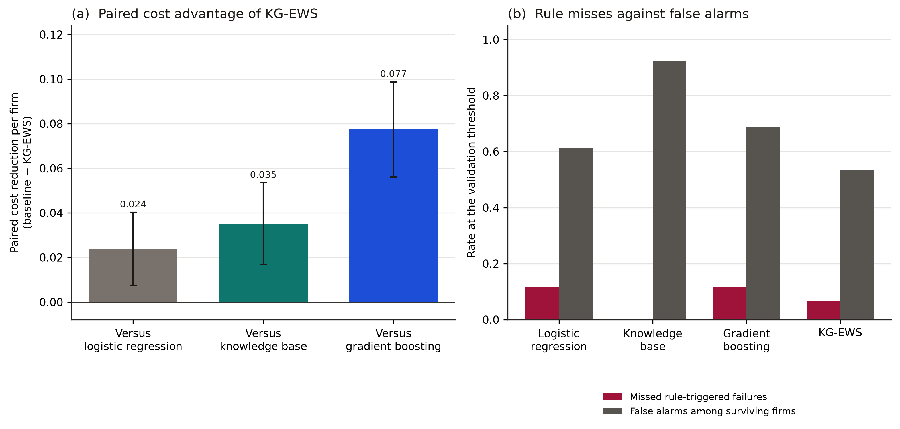

# A knowledge-guided early-warning system for digital-transformation failure in entrepreneurial firms

::: {.frontmatter}
Short Communication

Divya Munagala
:::

## Abstract

Digital-transformation failure in an entrepreneurial firm is a decision, not only a rank. A founder or investor has to catch a sharp failure of capability, innovation, or runway, and still not treat every financially stressed firm as failing. This short communication presents KG-EWS, a knowledge-guided early-warning score. Eight committee rules turn digital investment, capability, team experience, runway, customer concentration, pivots, and innovation throughput into a signed evidence term. That evidence is added to the log-odds of a logistic score fit on noisy measurements of the same firm. The evidence weight and the alert threshold are chosen on a validation slice to minimize a decision cost that charges a missed failure five times a false alarm. Across 120 reproducible cohorts of 380 ventures, KG-EWS reached a mean AUC of 0.765 and a mean decision cost of 0.598. Paired Wilcoxon tests favor it over logistic regression (cost advantage 0.024, 95% CI 0.008 to 0.040, p = 1.14×10⁻³; AUC advantage 0.022, p = 1.24×10⁻¹⁴), over gradient boosting, and over the rules used alone. The cost gain is cheaper in 59 cohorts, more expensive in 28, and identical in 33. It remains when a missed failure is charged three times a false alarm, and it is not detectable when the charge is eight. It does not survive a coding error that flips each predicate with probability 0.15. Used alone, the rules catch rule-triggered failures only by alarming on 92.2% of surviving firms, so the card that is issued is the combined score. The benchmark is synthetic and does not establish a calendar lead time.

**Keywords:** knowledge-based system; early warning; digital transformation; entrepreneurship; innovation; decision cost; venture data

## 1. Introduction

An entrepreneurial firm can invest in a digital offer and still fail because the capability, the team, or the innovation throughput never arrives. Founders and investors already describe those failures as rules: investment without capability, a digital offer without a digital team, a short runway beside a high burn multiple, and a pivot the market does not adopt. Early-warning research has a long statistical line, from discriminant ratios for corporate bankruptcy [1] to machine-learning scores for the same task [2]. Reviews of that line show that model choice and the definition of distress both change the reported accuracy [3,4]. A financial early-warning logit has been specified and then checked for whether its alerts are efficient [5]. Machine-learning scores have also been placed inside a decision-support system aimed at small-firm crisis over a horizon of months [6].

Digital-transformation research describes the capability gap that appears when investment runs ahead of operating skill [7,8] and treats the change as multidisciplinary [9,10]. Digital-entrepreneurship research treats the venture as the unit that must turn a technology into a repeatable business [11,12], which depends on capabilities the firm can reconfigure [13]. Studies of smaller firms connect that change to digital orientation and digital capability [14], to entrepreneurial persistence [15], to how a new venture configures its digital strategy [16], and to the digital-transformation capability of an entrepreneurial venture [17]. Mapping of that literature treats digital transformation and innovation as joint research themes [18]. Those lines are still usually published apart. One produces a probability. The other produces a narrative of capability. A decision maker needs both on the same card: the committee conjunctions have to stay visible, and the alert has to be chosen by a decision cost rather than by a default classification cutoff.

A probability from measured fields is not the same object as a rule a committee would code. Measured runway, burn, turbulence, and capability are noisy. The conjunction “high digital investment and low capability” is a threshold a linear score can only approximate. Knowledge-based and analytics-based decision support is the place where that conjunction is written down and then used in the score, rather than recovered after the fact as an explanation of a black box [19,20]. Bankruptcy models that turn ratios into images, or that read disclosure text, can separate failed firms without stating a rule a founder can contest [21,22]. Which measured fields are retained also changes a distress score [23].

This paper proposes KG-EWS. The contribution is threefold. First, a decision cost for entrepreneurial failure that charges each missed failure five times each false alarm, so the operating point is a warning policy rather than a default classification cutoff. Second, a knowledge-evidence term of eight production rules, added to the log-odds of a logistic score, with the weight chosen on validation data. Third, a reproducible benchmark of 120 cohorts in which the rules are coded on the operational state, the statistical models see only noisy measurements, and paired tests compare KG-EWS with logistic regression, gradient boosting, and the rules alone. The same program re-selects the evidence weight at two other miss costs and repeats the comparison after the predicates are corrupted, so the gain is reported together with the place it stops.

KG-EWS is not a claim that expert weights equal the true failure process. The expert weights and the data-generating coefficients are different numbers. It is also not a claim of a dated forecast. No failure date is generated. The output is a warning from the current profile.

## 2. KG-EWS

### 2.1 Decision cost

Let a venture be y = 1 if it fails and y = 0 otherwise. An alert is issued when a score s meets a threshold τ. Write FN for the number of failures with no alert and FP for the number of surviving firms that are alerted, in a cohort of n firms. The decision cost is

::: {.equation}
J = (5 FN + FP) / n. (1)
:::

The weight 5 is a preference: missing a failure is treated as five times as costly as one false alarm. It was fixed so that the two terms sit on a comparable scale, not estimated from a loss supplied by an investor. Alerting every firm costs about the share of firms that survive. A useful warning has to cut missed failures by more than the false alarms it adds. The same J is used to choose τ for every method, on the validation slice only.

Two failure modes are reported beside J, because a single miss rate hides them. A rule-triggered failure is a failed firm for which at least one risk rule in Section 2.2 fires. A smooth-stress failure is a failed firm for which none of those rules fires; its risk comes from runway, burn, turbulence, and concentration. Miss rates inside those two groups are descriptive. They are not extra terms in Eq. (1).

### 2.2 Knowledge-rule layer

The knowledge base is a set of eight production rules. Seven raise the failure evidence. One, P1, is protective. A rule fires only when every part of its antecedent holds on the operational state. The antecedents are:

- **R1.** Digital investment above 0.62 and capability below 0.38.
- **R2.** Digital investment above 0.58 and innovation throughput below 0.28.
- **R3.** Digital investment above 0.52 and team digital experience below 0.32.
- **R4.** Runway under 5.5 months and burn multiple above 2.2.
- **R5.** Customer concentration above 0.72 and market turbulence above 0.58.
- **R6.** At least three pivots and adoption lag above 0.65.
- **R7.** Team digital experience below 0.28, innovation throughput below 0.32, and digital investment above 0.48.
- **P1.** Capability above 0.68, innovation throughput above 0.58, and runway above 14 months.

Let zᵢ = 1 when rule i fires and 0 otherwise. The evidence is the signed sum

::: {.equation}
e = Σᵢ cᵢ zᵢ, (2)
:::

with expert weights c = (1.00, 0.85, 0.80, 0.95, 0.60, 0.55, 0.75, −1.05) in the order R1 through P1. These weights record direction and a rough magnitude. They are not fitted, and they are not equal to the coefficients of the failure process in Section 3. The construction follows the older idea that pieces of evidence can be written as modular contributions to a belief [20], here as a linear evidence term rather than a certainty-factor update, so that the weight λ in Eq. (3) stays visible.

### 2.3 The warning score

The measured-field model is a class-balanced logistic regression on ten noisy measurements: runway, burn multiple, digital investment, capability, innovation throughput, team digital experience, market turbulence, customer concentration, pivot count, and adoption lag. Predictors are standardized on the fit slice. Let p_Lin be its probability. KG-EWS adds the rule evidence on the log-odds scale,

::: {.equation}
s = σ( logit(p_Lin) + λ e ), (3)
:::

where σ is the logistic function and λ ≥ 0 is chosen from the grid {0, 0.2, …, 3.0} to minimize validation J. The alert threshold τ is then chosen on that same validation slice, again by minimizing J. If the rules do not help, the minimum is at λ = 0 and Eq. (3) returns the logistic score.

Gradient boosting [24] on the same noisy measurements is a baseline, not the carrier of the evidence. A shallow tree can in principle cut on the measured fields, but those fields are noisy copies of the state on which the committee codes the rules. The experiment asks whether that noise is enough to make the explicit rules worth adding.

**Algorithm 1. KG-EWS**

Input: noisy measurements x; committee predicates z; fit, validation, and test index sets

Output: test scores s and an alert threshold τ

1. Fit the logistic model and, separately, the gradient-boosting baseline on the fit slice.
2. Compute evidence e = Σ cᵢ zᵢ for every venture.
3. For each λ on the grid, form s = σ(logit(p_Lin) + λ e) on the validation slice and choose τ to minimize J.
4. Keep the λ whose best validation J is smallest.
5. Freeze that λ and its τ.
6. Return s and the alerts on the test slice, together with the identities of the rules that fired.

## 3. Experimental Design

The benchmark is synthetic and seeded. Every cohort can be regenerated from `ews.py` with cohort seed 9000 + k. There are 120 cohorts of 380 ventures. Each cohort is split into a fit slice (52.5%), a validation slice (17.5%), and a test slice (30%), stratified on the failure label. Models are fit once. λ and τ are chosen on the validation slice and frozen before the test slice is scored. Nothing in the reported means is computed on data that chose the weight or the threshold.

The operational state is drawn first. Runway is uniform on 1 to 24 months. Burn is lognormal. Digital investment, capability, innovation, team experience, turbulence, concentration, and adoption lag are beta draws. Pivot count is Poisson. Failure is then a Bernoulli draw with log-odds

::: {.equation}
η = −2.15 + 0.16(11 − runway) + 0.85(burn − 1.2) + 1.35 turbulence + 1.10 concentration + 1.70 R1 + 1.40 R2 + 1.20 R3 + 1.50 R4 + 1.00 R5 + 0.80 R6 + 1.15 R7 − 1.55 P1 + ε, (4)
:::

where ε is normal with mean 0 and standard deviation 0.35, and R1…P1 are the rule indicators of Section 2.2. The mean failure rate across cohorts is 32.6%. Of those failures, 35.0% are rule-triggered.

The statistical models do not see this state. They see a noisy copy: runway noise of scale 0.80 months, burn noise of scale 0.15, noise of scale 0.18 on the digital and team fields and on adoption lag, noise of scale 0.04 on turbulence and concentration, and noise of scale 0.70 on the pivot count. The committee rules are coded on the operational state, before that noise. This is the knowledge advantage under test. The predicate-flip block asks what remains of that advantage when the antecedents themselves are wrong.

Four scores are compared on every test slice: logistic regression, gradient boosting [24], the rule evidence passed through its own logistic map, and KG-EWS. Three of them are a two-by-two with the empty cell left out. Logistic regression is the measured model without the rules. The knowledge base is the rules without the measured model. KG-EWS is both. Gradient boosting is a second measured-field instrument, not a fourth cell of that design. Cohort-level costs and AUCs are paired. The test is a one-sided Wilcoxon signed-rank test [25] of whether KG-EWS has lower cost, and separately higher AUC, than each baseline. The mean paired difference is also reported with a 95% t interval, and each cohort is counted as better, worse, or tied, because a significant mean can coexist with a win in only half of the cohorts.

Two further checks are fixed in the program, not chosen after inspecting test costs. On the same 120 cohorts, λ and τ are selected again at miss weights 3 and 8, a lighter and a heavier preference around the primary weight of 5. Separately, 60 cohorts with seeds 12000 through 12059 flip each of the eight predicate bits independently with probability 0.15 before the evidence is summed. The failure label and the clean risk flag are left as drawn. The flip probability was set before those cohorts were generated. It was not scanned.

## 4. Results and Discussion

Table 1 is the mean across 120 test slices. The 95% interval for the mean cost is 0.579 to 0.617 for KG-EWS and 0.602 to 0.642 for logistic regression. Those two intervals nearly touch, so Figure 1a reports the paired difference inside each cohort rather than the two means side by side. Figure 1b is the trade that produces the cost: missed rule-triggered failures against false alarms among surviving firms.

| Method | AUC | Decision cost | Rule-miss | Smooth-miss | False-alarm rate |
| --- | ---: | ---: | ---: | ---: | ---: |
| Logistic regression | 0.743 | 0.622 | 0.118 | 0.137 | 0.614 |
| Knowledge base | 0.645 | 0.633 | 0.004 | 0.012 | 0.922 |
| Gradient boosting | 0.696 | 0.675 | 0.117 | 0.142 | 0.687 |
| KG-EWS | 0.765 | 0.598 | 0.067 | 0.194 | 0.536 |

: **Table 1.** Mean test-slice performance over 120 cohorts.

Decision cost is Eq. (1). Rule-miss is the share of rule-triggered failures with no alert. Smooth-miss is the share of other failures with no alert. The false-alarm rate is among surviving firms. Lower is better for cost, miss rates, and false alarms. Higher is better for AUC.

**Figure 1.** (a) Mean paired reduction in decision cost, baseline minus KG-EWS, with a 95% t interval across 120 cohorts. A bar above the zero line favors KG-EWS. (b) Missed rule-triggered failures and false alarms among surviving firms, at the validation threshold.

KG-EWS is the only score in Table 1 that leads on both AUC and decision cost. The separate 95% intervals for mean cost nearly touch, so the claim rests on the paired comparison in Figure 1a and Table 2. The logistic interval in Figure 1a lies above zero.

The knowledge base is not a competing operating point. Case-based reasoning has already been used for financial-distress prediction in this knowledge-based line [26]. Listed-company distress scores have also been merged with rough sets and Dempster–Shafer evidence, and that combination was reported to beat a single classifier [27]. KG-EWS does not fuse several statistical classifiers. It adds one block of committee-rule evidence to one logistic score. The rule-miss rate of the knowledge base in Table 1 is 0.004, which looks decisive in isolation and is not. The cost-minimizing threshold on that score alarms on 92.2% of surviving firms. A rule probability that does not separate the middle of the cohort is pushed, by the 5:1 cost, toward warning on almost everyone. That is why the rules enter Eq. (3) as evidence on top of a measured-field score, rather than as the sole probability, which is the role of a financial early-warning logit [5].

Gradient boosting does not recover the committee rules from the noisy measurements. Its AUC is 0.047 below the logistic score and 0.069 below KG-EWS, and its cost is the worst of the four. Depth-three trees are a poor instrument for a mostly additive measurement model observed with noise. The interactions that matter are already written as rules. Deeper image and text models can separate bankrupt firms in other settings [21,22]. They are not the baseline required to test whether these eight rules add evidence the noisy fields do not carry.

The trade inside KG-EWS is visible in Table 1 and should not be smoothed over. Relative to logistic regression, rule-miss falls from 0.118 to 0.067 and the false-alarm rate falls from 0.614 to 0.536, while smooth-miss rises from 0.137 to 0.194. Shifting the log-odds toward firms that fire R1–R7 spends some of the alert budget on conjunctions and away from failures that have no rule. Eq. (1) says that exchange is worth making under the stated preference: the net cost falls. A user who cares only about smooth financial stress would keep λ at 0. The validation rule does that when the evidence does not earn its keep. λ was positive in 90 of the 120 cohorts. The mean λ was 0.78 (SD 0.81).

The same four rows are the ablation. Removing the measured model, which leaves the knowledge base, raises mean cost from 0.598 to 0.633 and drops AUC from 0.765 to 0.645. Removing the rules, which leaves logistic regression, raises mean cost by 0.024 and drops AUC by 0.022. The measured-field score is what makes the committee rules usable. The knowledge layer is a smaller correction on top of a strong linear baseline. For a founder watching digital capability [7,8,14], that correction is the part of the card that can be argued in words. It is not, on these cohorts, the larger share of the predictive gain.

| Comparison | Metric | Advantage | 95% CI | Better / worse / tied | p-value |
| --- | --- | ---: | --- | ---: | ---: |
| Versus logistic regression | Decision cost | 0.024 | 0.008 to 0.040 | 59 / 28 / 33 | 1.14×10⁻³ |
| Versus logistic regression | AUC | 0.022 | 0.017 to 0.027 | 84 / 6 / 30 | 1.24×10⁻¹⁴ |
| Versus gradient boosting | Decision cost | 0.077 | 0.056 to 0.099 | 91 / 28 / 1 | 2.08×10⁻¹⁰ |
| Versus gradient boosting | AUC | 0.069 | 0.061 to 0.076 | 117 / 3 / 0 | 1.30×10⁻²¹ |
| Versus knowledge base | Decision cost | 0.035 | 0.017 to 0.054 | 81 / 35 / 4 | 2.91×10⁻⁵ |
| Versus knowledge base | AUC | 0.121 | 0.112 to 0.130 | 119 / 1 / 0 | 2.37×10⁻²¹ |

: **Table 2.** Paired comparisons on the 120 cohort-level test results.

The advantage is the baseline cost minus the KG-EWS cost, or the KG-EWS AUC minus the baseline AUC. The interval is a 95% t interval for that mean paired difference. Counts are cohorts in which KG-EWS was better, worse, or tied. The p-value is a one-sided Wilcoxon signed-rank test [25]. Positive advantages favor KG-EWS.

The gain over logistic regression is the small one, and it is the gain that matters. Logistic regression already fits the additive part of Eq. (4). The rules add the conjunctions that survive measurement noise. An AUC lift of 0.022 and a cost lift of 0.024 is the right size of claim for that addition. It is not a win in every cohort. Of the 33 cost ties, 30 are the cohorts that set λ to 0 and therefore returned the logistic score. Of the 90 cohorts that used the evidence, KG-EWS was cheaper in 59, more expensive in 28, and tied in 3. Where it was cheaper the mean gap was 0.086. Where it was more expensive the mean gap was −0.080. The paired mean stays positive because the favorable gaps are slightly larger and more numerous. The AUC comparison is more consistent: once λ is positive, AUC rises in 84 of those 90 cohorts and falls in 6. The larger gaps against gradient boosting and against the rules alone are mostly gaps between a weak instrument and a suitable one.

Bankruptcy models for listed firms have been ranked by the financial cost of failure and by jobs lost, and the preferred model changes with that metric [28]. The weight in Eq. (1) is narrower. It is a fixed five-to-one charge on a missed failure against a false alarm, stated in advance and not estimated from those costs. The 5:1 weight is not the only preference at which this ranking can be asked. λ and τ were selected again at miss weights 3 and 8. At weight 3 the mean test cost was 0.493 for KG-EWS and 0.523 for logistic regression (advantage 0.030, 95% CI 0.019 to 0.041, cheaper in 70 cohorts, p = 6.14×10⁻⁷). Mean λ rose to 1.01 and was positive in 100 cohorts. At weight 8 the mean costs were 0.685 and 0.681 (advantage −0.004, 95% CI −0.026 to 0.018, cheaper in 52 cohorts, more expensive in 31, tied in 37, p = 0.135). A heavier charge on a miss pushes both policies toward alerting more firms, and the rule evidence no longer earns a detectable cost reduction.

The predicate check names the other boundary. On the 60 cohorts with corrupted antecedents, the paired cost advantage over logistic regression is −0.015 (95% CI −0.036 to 0.006, cheaper in 18 cohorts, more expensive in 24, tied in 18, p = 0.892). The AUC advantage is −0.004 (95% CI −0.012 to 0.004, p = 0.527). λ stays positive in 42 of the 60 cohorts, with mean 0.46, so the validation rule does not fully switch the evidence off. The corrupted rules alone fall to a mean AUC of 0.578 and a mean cost of 0.722. KG-EWS remains cheaper than that rule score by 0.082 (p = 1.19×10⁻⁴). Rule-miss under KG-EWS is 0.128, against 0.130 for logistic regression. The conjunctions stop paying for themselves when the antecedents are wrong with probability 0.15.

One test venture from the same protocol is the case, among firms with λ > 0, with the largest lift of the KG-EWS probability over the logistic probability. R1, R2, R3, and R7 fire together: digital investment without capability, without innovation throughput, and without a digital team. Logistic regression scores the firm at 0.118 and gradient boosting at 0.016. The rule score is 0.971. KG-EWS scores it at 0.999. The card names the four rules. That is the decision-support content of the method. Studies of digital orientation, persistence, and venture strategy are the setting in which a committee would argue about capability and investment [14–17]. They do not produce this alert.

For a founder or investor the practical reading is limited and specific. Under a 5:1 preference, and when the committee codes the antecedents correctly, the card lowers decision cost by a small paired amount and says which rules fired. It still alerts on about half of surviving firms, because that is what Eq. (1) buys. It is not a screen that stays quiet. It is not evidence that digital strategy, taken from survey studies [15–17], predicts failure in the field.

## 5. Limitations

At a miss weight of 8 the paired advantage over logistic regression is compatible with zero. A founder who will not alarm on about half of surviving firms, which is still the KG-EWS false-alarm rate under the primary ratio, would choose a higher threshold than the minimizer of Eq. (1) and would miss more failures. The two neighboring weights are not a full map of the loss surface.

The clean-predicate benchmark is the favorable case for the evidence term. The 60-cohort stress test puts a 0.15 flip on the predicates, and the advantage over logistic regression does not survive. λ remained positive in most of those cohorts, so validation is an incomplete protection. The generator also plants the same antecedents that the knowledge base uses. The expert weights are not the data-generating coefficients, but the thresholds are the same thresholds. This is a recovery benchmark for a stated rule set, not a discovery of rules from text or from a shifted set of cutpoints.

There is no clock. Dynamic distress models for listed companies reweight older financial statements when the failure process drifts [29]. A firm here is a single draw, not a path observed months before closure. Nothing here is a lead time. Calling the output an early warning means that it is issued from the current profile for a decision that can still be taken. The cohorts are independent draws from one process. They are not a sample of industries, countries, or funding regimes. Field records with a failure date, a feature cutoff before that date, and predicates coded by people who do not know the outcome are the next test. Eq. (1) and Eq. (3) do not have to change for that test. The predicates and the noise model do.

## 6. Conclusion

KG-EWS is a warning card for digital-transformation failure in entrepreneurial firms. Eight committee rules supply a signed evidence term. A logistic score supplies the additive risk that can be read from noisy measurements. The validation slice decides how much evidence to add, and whether to add any. On 120 synthetic cohorts the combined score has the lowest decision cost and the highest AUC of the four instruments compared. The rules alone are not a usable policy. The gain over logistic regression is small: cheaper in 59 cohorts, more expensive in 28, and identical in 33. It remains under a 3:1 miss weight, is not detectable under an 8:1 weight, and disappears when each predicate is flipped with probability 0.15. The data are a recovery benchmark whose rules and failure process share their thresholds. That is the claim the experiment supports.

## Data Availability

The cohorts are synthetic. `ews.py` generates the ventures, fits every model, chooses λ and τ, repeats that choice at miss weights 3 and 8, runs the 60-cohort predicate-flip check, writes `cohort_results.csv`, and redraws the figure. The primary seeds are 9000 through 9119. The stress seeds are 12000 through 12059. The program and the cohort table are in the public repository https://github.com/divzmunagala03-tech/Dba. No external data file is required.

## Declaration of Competing Interest

The author declares that there are no known competing financial interests or personal relationships that could have appeared to influence the work reported in this manuscript.

## Declaration of generative AI and AI-assisted technologies in the manuscript preparation process

During the preparation of this work the author used Cursor, with large language model assistance, for language drafting, organization, and code structuring. After using this tool, the author reviewed and edited the content as needed and takes full responsibility for the content of the published article. The experimental results, tables, and figures were produced by executing `ews.py`.

## Funding

This research did not receive any specific grant from funding agencies in the public, commercial, or not-for-profit sectors.

## CRediT Authorship Contribution Statement

**Divya Munagala:** Conceptualization, Methodology, Software, Validation, Formal analysis, Investigation, Writing – original draft, Writing – review and editing, Visualization.

## References

::: {.refs}
[1] Altman, E. I. (1968). Financial ratios, discriminant analysis and the prediction of corporate bankruptcy. The Journal of Finance, 23(4), 589–609. https://doi.org/10.2307/2978933

[2] Barboza, F., Kimura, H., & Altman, E. (2017). Machine learning models and bankruptcy prediction. Expert Systems with Applications, 83, 405–417. https://doi.org/10.1016/j.eswa.2017.04.006

[3] Alaka, H. A., Oyedele, L. O., Owolabi, H. A., Kumar, V., Ajayi, S. O., Akinade, O. O., & Bilal, M. (2018). Systematic review of bankruptcy prediction models: Towards a framework for tool selection. Expert Systems with Applications, 94, 164–184. https://doi.org/10.1016/j.eswa.2017.10.040

[4] Sun, J., Li, H., Huang, Q.-H., & He, K.-Y. (2014). Predicting financial distress and corporate failure: A review from the state-of-the-art definitions, modeling, sampling, and featuring approaches. Knowledge-Based Systems, 57, 41–56. https://doi.org/10.1016/j.knosys.2013.12.006

[5] Li, S., & Wang, S. (2014). A financial early warning logit model and its efficiency verification approach. Knowledge-Based Systems, 70, 78–87. https://doi.org/10.1016/j.knosys.2014.03.017

[6] Perboli, G., & Arabnezhad, E. (2021). A machine learning-based DSS for mid and long-term company crisis prediction. Expert Systems with Applications, 174, 114758. https://doi.org/10.1016/j.eswa.2021.114758

[7] Vial, G. (2019). Understanding digital transformation: A review and a research agenda. The Journal of Strategic Information Systems, 28(2), 118–144. https://doi.org/10.1016/j.jsis.2019.01.003

[8] Warner, K. S. R., & Wäger, M. (2019). Building dynamic capabilities for digital transformation: An ongoing process of strategic renewal. Long Range Planning, 52(3), 326–349. https://doi.org/10.1016/j.lrp.2018.12.001

[9] Verhoef, P. C., Broekhuizen, T., Bart, Y., Bhattacharya, A., Dong, J. Q., Fabian, N., & Haenlein, M. (2021). Digital transformation: A multidisciplinary reflection and research agenda. Journal of Business Research, 122, 889–901. https://doi.org/10.1016/j.jbusres.2019.09.022

[10] Kraus, S., Durst, S., Ferreira, J. J., Veiga, P., Kailer, N., & Weinmann, A. (2022). Digital transformation in business and management research: An overview of the current status quo. International Journal of Information Management, 63, 102466. https://doi.org/10.1016/j.ijinfomgt.2021.102466

[11] Nambisan, S. (2017). Digital entrepreneurship: Toward a digital technology perspective of entrepreneurship. Entrepreneurship Theory and Practice, 41(6), 1029–1055. https://doi.org/10.1111/etap.12254

[12] Nambisan, S., Wright, M., & Feldman, M. (2019). The digital transformation of innovation and entrepreneurship: Progress, challenges and key themes. Research Policy, 48(8), 103773. https://doi.org/10.1016/j.respol.2019.03.018

[13] Teece, D. J. (2007). Explicating dynamic capabilities: The nature and microfoundations of (sustainable) enterprise performance. Strategic Management Journal, 28(13), 1319–1350. https://doi.org/10.1002/smj.640

[14] Rupeika-Apoga, R., Petrovska, K., & Bule, L. (2022). The effect of digital orientation and digital capability on digital transformation of SMEs during the COVID-19 pandemic. Journal of Theoretical and Applied Electronic Commerce Research, 17(2), 669–685. https://doi.org/10.3390/jtaer17020035

[15] Christofi, M., Khan, H., Zahoor, N., Hadjielias, E., & Tarba, S. (2024). Digital transformation of SMEs: The role of entrepreneurial persistence and market sensing dynamic capability. IEEE Transactions on Engineering Management, 71, 13598–13615. https://doi.org/10.1109/TEM.2022.3230248

[16] Wang, H., & Wu, W. (2024). The effects of digital technology strategy configurations on new venture performance. IEEE Transactions on Engineering Management, 71, 5470–5486. https://doi.org/10.1109/TEM.2024.3363625

[17] Kumar, V., Kumar, S., Chatterjee, S., & Mariani, M. (2024). Optimizing the digital transformation capability for enhancing economic sustainability of entrepreneurial venture: The moderating role of entrepreneurial orientation. IEEE Transactions on Engineering Management, 71, 8517–8530. https://doi.org/10.1109/TEM.2024.3387540

[18] Gao, P., Wu, W., & Yang, Y. (2022). Discovering themes and trends in digital transformation and innovation research. Journal of Theoretical and Applied Electronic Commerce Research, 17(3), 1162–1184. https://doi.org/10.3390/jtaer17030059

[19] Chen, H., Chiang, R. H. L., & Storey, V. C. (2012). Business intelligence and analytics: From big data to big impact. MIS Quarterly, 36(4), 1165–1188. https://doi.org/10.2307/41703503

[20] Shortliffe, E. H., & Buchanan, B. G. (1975). A model of inexact reasoning in medicine. Mathematical Biosciences, 23(3–4), 351–379. https://doi.org/10.1016/0025-5564(75)90047-4

[21] Hosaka, T. (2019). Bankruptcy prediction using imaged financial ratios and convolutional neural networks. Expert Systems with Applications, 117, 287–299. https://doi.org/10.1016/j.eswa.2018.09.039

[22] Mai, F., Tian, S., Lee, C., & Ma, L. (2019). Deep learning models for bankruptcy prediction using textual disclosures. European Journal of Operational Research, 274(2), 743–758. https://doi.org/10.1016/j.ejor.2018.10.024

[23] Liang, D., Tsai, C.-F., & Wu, H.-T. (2015). The effect of feature selection on financial distress prediction. Knowledge-Based Systems, 73, 289–297. https://doi.org/10.1016/j.knosys.2014.10.010

[24] Friedman, J. H. (2001). Greedy function approximation: A gradient boosting machine. The Annals of Statistics, 29(5), 1189–1232. https://doi.org/10.1214/aos/1013203451

[25] Wilcoxon, F. (1945). Individual comparisons by ranking methods. Biometrics Bulletin, 1(6), 80–83. https://doi.org/10.2307/3001968

[26] Li, H., & Sun, J. (2008). Ranking-order case-based reasoning for financial distress prediction. Knowledge-Based Systems, 21(8), 868–878. https://doi.org/10.1016/j.knosys.2008.03.047

[27] Xiao, Z., Yang, X., Pang, Y., & Dang, X. (2012). The prediction for listed companies’ financial distress by using multiple prediction methods with rough set and Dempster–Shafer evidence theory. Knowledge-Based Systems, 26, 196–206. https://doi.org/10.1016/j.knosys.2011.08.001

[28] Radovanovic, J., & Haas, C. (2023). The evaluation of bankruptcy prediction models based on socio-economic costs. Expert Systems with Applications, 227, 120275. https://doi.org/10.1016/j.eswa.2023.120275

[29] Sun, J., Fujita, H., Chen, P., & Li, H. (2017). Dynamic financial distress prediction with concept drift based on time weighting combined with Adaboost support vector machine ensemble. Knowledge-Based Systems, 120, 4–14. https://doi.org/10.1016/j.knosys.2016.12.019
:::
