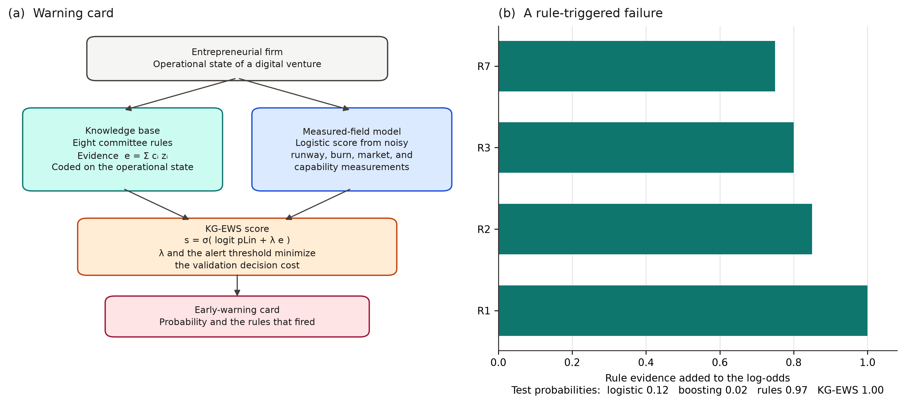
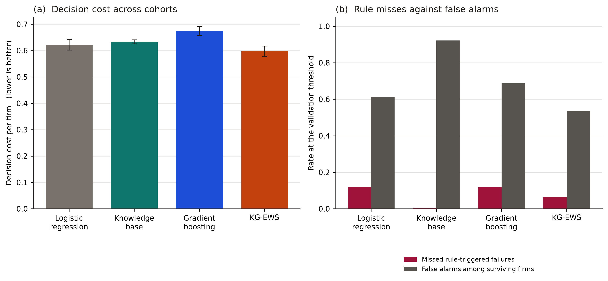

# A knowledge-guided early-warning system for digital-transformation failure in entrepreneurial firms

**Short communication**

**Authors and affiliations.** To be added by the submitting authors.

## Abstract

Digital-transformation failure in an entrepreneurial firm is a decision, not only a rank. A founder or investor has to catch a sharp failure of capability, innovation, or runway, and still not treat every financially stressed firm as failing. This short communication presents KG-EWS, a knowledge-guided early-warning score. Eight committee rules turn digital investment, capability, team experience, runway, customer concentration, pivots, and innovation throughput into a signed evidence term. That evidence is added to the log-odds of a logistic score fit on noisy measurements of the same firm. The evidence weight and the alert threshold are chosen on a validation slice to minimize a decision cost that charges a missed failure five times a false alarm. Across 120 reproducible cohorts of 380 ventures, KG-EWS reached a mean AUC of 0.765 and a mean decision cost of 0.598. Paired Wilcoxon tests favor it over logistic regression (cost advantage 0.024, p = 1.14×10⁻³; AUC advantage 0.022, p = 1.24×10⁻¹⁴), over gradient boosting, and over the rules used alone. Used alone, the rules catch rule-triggered failures only by alarming 92.2% of surviving firms, so the card that is issued is the combined score. The benchmark is synthetic and does not establish a calendar lead time.

**Keywords:** knowledge-based system; early-warning system; digital transformation; entrepreneurship; innovation; decision cost; venture data

## 1. Introduction

An entrepreneurial firm can invest in a digital offer and still fail because the capability, the team, or the innovation throughput never arrives. Founders and investors already describe those failures as rules: investment without capability, a cloud or data offer without a digital team, a short runway beside a high burn multiple, a disruptive pivot that the market does not adopt. Early-warning research has a long statistical line, from discriminant ratios for corporate bankruptcy [1] to machine-learning scores for the same task [2]. Digital-transformation research describes the capability gap that appears when investment runs ahead of operating skill [3,4], and digital-entrepreneurship research treats the venture as the unit that must turn a technology into a repeatable business [5,6]. Those lines are usually published apart. One produces a probability. The other produces a narrative of capability. A decision maker needs both on the same card.

A probability from measured fields is not the same object as a rule a committee would code. Measured runway, burn, turbulence, and capability are noisy. The conjunction “high digital investment and low capability” is a threshold a linear score can only approximate, and a tree can miss when the measurements that define the threshold are the noisy ones. Knowledge-based decision support is the place where that conjunction is written down and then used in the score, rather than recovered after the fact as an explanation of a black box [7,8].

This paper proposes KG-EWS. The contribution is threefold. First, a decision cost for entrepreneurial failure that charges each missed failure five times each false alarm, so the operating point is a warning policy rather than a default classification cutoff. Second, a knowledge-evidence term of eight production rules, added to the log-odds of a logistic score, with the weight chosen on validation data. Third, a reproducible benchmark of 120 cohorts in which the rules are coded on the operational state, the statistical models see only noisy measurements, and paired tests compare KG-EWS with logistic regression, gradient boosting, and the rules alone.

KG-EWS is not a claim that expert weights equal the true failure process. The expert weights and the data-generating coefficients are different numbers. It is also not a claim of a dated forecast. No failure date is generated. The output is a warning from the current profile.

## 2. KG-EWS

### 2.1 Decision cost

Let a venture be y = 1 if it fails and y = 0 otherwise. An alert is issued when a score s meets a threshold τ. Write FN for the number of failures with no alert and FP for the number of surviving firms that are alerted, in a cohort of n firms. The decision cost is

J = (5 FN + FP) / n. (1)

The weight 5 is a preference: missing a failure is treated as five times as costly as one false alarm. It was fixed so that the two terms sit on a comparable scale, not estimated from a loss function supplied by an investor. Alerting every firm costs about the share of firms that survive. A useful warning has to cut missed failures by more than the false alarms it adds. The same J is used to choose τ for every method, on the validation slice only.

Two failure modes are reported beside J, because a single miss rate hides them. A rule-triggered failure is a failed firm for which at least one risk rule in Section 2.2 fires. A smooth-stress failure is a failed firm for which none of those rules fires; its risk comes from runway, burn, turbulence, and concentration. Miss rates inside those two groups are descriptive. They are not extra terms in Eq. (1).

### 2.2 Knowledge-rule layer

The knowledge base is a set of eight production rules. Seven raise the failure evidence. One, P1, is protective. A rule fires only when every part of its antecedent holds on the operational state. The antecedents are:

- **R1.** Digital investment above 0.62 and capability below 0.38.
- **R2.** Digital investment above 0.58 and innovation throughput below 0.28.
- **R3.** Digital investment above 0.52 and team digital experience below 0.32.
- **R4.** Runway under 5.5 months and burn multiple above 2.2.
- **R5.** Customer concentration above 0.72 and market turbulence above 0.58.
- **R6.** At least three pivots and adoption lag above 0.65.
- **R7.** Team digital experience below 0.28, innovation throughput below 0.32, and digital investment above 0.48.
- **P1.** Capability above 0.68, innovation throughput above 0.58, and runway above 14 months.

Let zᵢ = 1 when rule i fires and 0 otherwise. The evidence is the signed sum

e = Σᵢ cᵢ zᵢ, (2)

with expert weights c = (1.00, 0.85, 0.80, 0.95, 0.60, 0.55, 0.75, −1.05) in the order R1 through P1. These weights record direction and a rough magnitude. They are not fitted, and they are not equal to the coefficients of the failure process in Section 3. The construction follows the older idea that pieces of evidence can be written as modular contributions to a belief [8], here as a linear evidence term rather than a certainty-factor update, so that the weight λ in Eq. (3) stays visible.

### 2.3 The warning score

The measured-field model is a class-balanced logistic regression on ten noisy measurements: runway, burn multiple, digital investment, capability, innovation throughput, team digital experience, market turbulence, customer concentration, pivot count, and adoption lag. Predictors are standardized on the fit slice. Let p_Lin be its probability. KG-EWS adds the rule evidence on the log-odds scale,

s = σ( logit(p_Lin) + λ e ), (3)

where σ is the logistic function and λ ≥ 0 is chosen from the grid {0, 0.2, …, 3.0} to minimize validation J. The alert threshold τ is then chosen on that same validation slice, again by minimizing J. If the rules do not help, the minimum is at λ = 0 and Eq. (3) returns the logistic score.

Gradient boosting on the same noisy measurements is a baseline, not the carrier of the evidence. A shallow tree can in principle cut on the measured fields, but those fields are noisy copies of the state on which the committee codes the rules. The experiment asks whether that noise is enough to make the explicit rules worth adding.

**Algorithm 1. KG-EWS**

Input: noisy measurements x; committee predicates z; fit, validation, and test index sets

Output: test scores s and an alert threshold τ

1. Fit the logistic model and, separately, the gradient-boosting baseline on the fit slice.
2. Compute evidence e = Σ cᵢ zᵢ for every venture.
3. For each λ on the grid, form s = σ(logit(p_Lin) + λ e) on the validation slice and choose τ to minimize J.
4. Keep the λ whose best validation J is smallest.
5. Freeze that λ and its τ.
6. Return s and the alerts on the test slice, together with the identities of the rules that fired.

Figure 1a is this card. Figure 1b is one test venture on which the card changes the warning.

**Figure 1.** (a) The warning card. Committee rules are coded on the operational state. The logistic score uses noisy measurements. (b) One rule-triggered test failure. R1, R2, R3, and R7 fire. Logistic probability 0.118, gradient boosting 0.016, rules alone 0.971, KG-EWS 0.999.

## 3. Experimental design

The benchmark is synthetic and seeded, in the same spirit as a controlled decision benchmark: every cohort can be regenerated from `ews.py` with cohort seed 9000 + k. There are 120 cohorts of 380 ventures. Each cohort is split into a fit slice (52.5%), a validation slice (17.5%), and a test slice (30%), stratified on the failure label. Models are fit once. λ and τ are chosen on the validation slice and frozen before the test slice is scored. Nothing in the reported means is computed on data that chose the weight or the threshold.

The operational state is drawn first. Runway is uniform on 1 to 24 months. Burn is lognormal. Digital investment, capability, innovation, team experience, turbulence, concentration, and adoption lag are beta draws. Pivot count is Poisson. Failure is then a Bernoulli draw with log-odds

η = −2.15 + 0.16(11 − runway) + 0.85(burn − 1.2) + 1.35 turbulence + 1.10 concentration + 1.70 R1 + 1.40 R2 + 1.20 R3 + 1.50 R4 + 1.00 R5 + 0.80 R6 + 1.15 R7 − 1.55 P1 + ε, (4)

where ε is normal with mean 0 and standard deviation 0.35, and R1…P1 are the rule indicators of Section 2.2. The mean failure rate across cohorts is 32.6%. Of those failures, 35.0% are rule-triggered.

The statistical models do not see this state. They see a noisy copy: runway noise of scale 0.80 months, burn noise of scale 0.15, noise of scale 0.18 on the digital and team fields and on adoption lag, noise of scale 0.04 on turbulence and concentration, and noise of scale 0.70 on the pivot count. The committee rules are coded on the operational state, before that noise. This is the knowledge advantage under test. It is also a bound on the claim: a field committee that miscoded the predicates would give the evidence term a weaker, or a wrong, input.

Four scores are compared on every test slice: logistic regression, gradient boosting [9], the rule evidence passed through its own logistic map, and KG-EWS. Cohort-level costs and AUCs are paired. The test is a Wilcoxon signed-rank test [10] of whether KG-EWS has lower cost, and separately higher AUC, than each baseline.

## 4. Results and discussion

Table 1 is the mean across 120 test slices. Figure 2a is the same cost with a 95% confidence interval for the mean. Figure 2b is the trade that produces the cost: missed rule-triggered failures against false alarms among surviving firms.

**Table 1.** Mean test-slice performance over 120 cohorts. Decision cost is Eq. (1). Rule-miss is the share of rule-triggered failures with no alert. Smooth-miss is the share of other failures with no alert. The false-alarm rate is among surviving firms. Lower is better for cost, miss rates, and false alarms. Higher is better for AUC.

| Method | AUC | Decision cost | Rule-miss | Smooth-miss | False-alarm rate |
| --- | ---: | ---: | ---: | ---: | ---: |
| Logistic regression | 0.743 | 0.622 | 0.118 | 0.137 | 0.614 |
| Knowledge base | 0.645 | 0.633 | 0.004 | 0.012 | 0.922 |
| Gradient boosting | 0.696 | 0.675 | 0.117 | 0.142 | 0.687 |
| KG-EWS | 0.765 | 0.598 | 0.067 | 0.194 | 0.536 |

**Figure 2.** (a) Mean decision cost per firm, with a 95% t interval for the mean across 120 cohorts. (b) Missed rule-triggered failures and false alarms among surviving firms, at the validation threshold.

KG-EWS is the only score that leads both columns a decision maker would optimize together. Mean AUC is 0.765 against 0.743 for logistic regression, 0.696 for gradient boosting, and 0.645 for the rules alone. Mean cost is 0.598 against 0.622, 0.675, and 0.633. The interval in Figure 2a for KG-EWS is 0.579 to 0.617. The logistic interval is 0.602 to 0.642. They nearly touch, which is why the paired test in Table 2 matters more than the two intervals read separately: the comparison is inside the cohort, not between two independent means.

The knowledge base is not a competing operating point. Its rule-miss rate is 0.004, which looks decisive in isolation and is not. The cost-minimizing threshold on that score alarms on 92.2% of surviving firms. A rule probability that does not separate the middle of the cohort is pushed, by the 5:1 cost, toward warning on almost everyone. That is the reason the rules enter Eq. (3) as evidence on top of a measured-field score, rather than as the probability that is shown to the founder.

Gradient boosting does not recover the committee rules from the noisy measurements. Its AUC is 0.048 below the logistic score and 0.069 below KG-EWS, and its cost is the worst of the four. Depth-three trees are the wrong instrument for a mostly additive measurement model observed with noise. The interactions that matter are already written as rules.

The trade inside KG-EWS is visible in Table 1 and should not be smoothed over. Relative to logistic regression, rule-miss falls from 0.118 to 0.067 and the false-alarm rate falls from 0.614 to 0.536, while smooth-miss rises from 0.137 to 0.194. Shifting the log-odds toward firms that fire R1–R7 spends some of the alert budget on conjunctions and away from failures that have no rule. Eq. (1) says that exchange is worth making: the net cost falls. A user who cares only about smooth financial stress, and not about capability or innovation failures, would keep λ at 0. The validation rule does that when the evidence does not earn its keep. λ was positive in 90 of the 120 cohorts. The mean λ was 0.78 (SD 0.81).

**Table 2.** Paired Wilcoxon tests of KG-EWS against each baseline, using the 120 cohort-level test results. The cost advantage is the baseline cost minus the KG-EWS cost. The AUC advantage is the KG-EWS AUC minus the baseline AUC. Positive advantages favor KG-EWS.

| Comparison | Metric | Baseline | KG-EWS | Advantage | p-value |
| --- | --- | ---: | ---: | ---: | ---: |
| Versus logistic regression | Decision cost | 0.622 | 0.598 | 0.024 | 1.14×10⁻³ |
| Versus logistic regression | AUC | 0.743 | 0.765 | 0.022 | 1.24×10⁻¹⁴ |
| Versus gradient boosting | Decision cost | 0.675 | 0.598 | 0.077 | 2.08×10⁻¹⁰ |
| Versus gradient boosting | AUC | 0.696 | 0.765 | 0.069 | 1.30×10⁻²¹ |
| Versus knowledge base | Decision cost | 0.633 | 0.598 | 0.035 | 2.91×10⁻⁵ |
| Versus knowledge base | AUC | 0.645 | 0.765 | 0.121 | 2.37×10⁻²¹ |

The gain over logistic regression is the small one, and it is the gain that matters. Logistic regression is the strong baseline: it already fits the additive part of Eq. (4). The rules add the conjunctions that survive measurement noise. An AUC lift of 0.022 and a cost lift of 0.024, each consistent across paired cohorts, is the right size of claim for that addition. The much larger gap against gradient boosting and against the rules alone is mostly the gap between a weak instrument and a suitable one. It is reported so that those instruments are not left as implied alternatives.

Figure 1b is one test venture, not a selected success story from outside the protocol. It is the test case, among firms with λ > 0, with the largest lift of the KG-EWS probability over the logistic probability. R1, R2, R3, and R7 fire together: digital investment without capability, without innovation throughput, and without a digital team. The noisy measurements do not carry that conjunction. Logistic regression scores the firm at 0.118 and gradient boosting at 0.016. The rule score is 0.971. KG-EWS, with the evidence added to the logistic log-odds, scores it at 0.999. The card names the four rules. That is the decision-support content of the method: the probability moves because those rules fired, and the rules are the sentence a person can argue with.

## 5. Limitations

The benchmark does not show what happens when the cost ratio is not 5:1. A founder who is unwilling to alarm on about half of surviving firms, which is still the KG-EWS false-alarm rate under this ratio, would choose a higher threshold and would miss more failures. Eq. (1) makes that preference explicit. It does not estimate it.

The committee predicates are coded on the clean operational state. Measurement noise is applied only to the fields the statistical models see. A human committee would miscode some antecedents. That error is not in the present design, and it would shrink the advantage of e over p_Lin. The generator also plants the same antecedents that the knowledge base uses. The expert weights are not the data-generating coefficients, but the thresholds are the same thresholds. This is a recovery benchmark for a stated rule set, not a discovery of the rules from unlabeled text.

There is no clock. A firm is a single draw, not a path observed months before closure. Nothing here is a lead time. Calling the output an early warning means that it is a warning issued from the current profile for a decision that can still be taken, not that the score has been shown to move before the failure.

The cohorts are independent draws from one process. They are not a sample of industries, countries, or funding regimes. Field records with a failure date, a feature cutoff before that date, and predicates coded by people who do not know the outcome are the next test. The decision cost and the evidence equation do not have to change for that test. The predicates and the noise model do.

## 6. Conclusion

KG-EWS is a warning card for digital-transformation failure in entrepreneurial firms. Eight committee rules supply a signed evidence term. A logistic score supplies the additive risk that can be read from noisy measurements. The validation slice decides how much evidence to add, and whether to add any. On 120 synthetic cohorts the combined score has the lowest decision cost and the highest AUC of the four instruments compared. The rules alone are not a usable policy: they catch conjunction failures by alarming on nearly every surviving firm. Gradient boosting on the noisy measurements does not replace the rules. The gain over logistic regression is small, paired, and confined to a benchmark whose rules and failure process share their thresholds. That is the claim the experiment supports.

## Data availability

The cohorts are synthetic. `ews.py` generates the ventures, fits every model, chooses λ and τ, writes `cohort_results.csv`, and redraws both figures. The cohort seeds are 9000 through 9119. No external data file is required.

## Declaration of competing interest

The authors declare that they have no known competing financial interests or personal relationships that could have appeared to influence the work reported in this manuscript.

## Declaration of generative AI and AI-assisted technologies

During preparation of this manuscript, AI-assisted tools were used for language drafting, organization, and code structuring. The experimental results, tables, and figures were produced by executing `ews.py`. The submitting authors review the content and take responsibility for the final manuscript.

## Funding

This research received no specific grant from any funding agency in the public, commercial, or not-for-profit sectors.

## References

[1] Altman, E. I. (1968). Financial ratios, discriminant analysis and the prediction of corporate bankruptcy. *The Journal of Finance*, 23(4), 589–609.

[2] Barboza, F., Kimura, H., & Altman, E. (2017). Machine learning models and bankruptcy prediction. *Expert Systems with Applications*, 83, 405–417.

[3] Vial, G. (2019). Understanding digital transformation: A review and a research agenda. *The Journal of Strategic Information Systems*, 28(2), 118–144.

[4] Warner, K. S. R., & Wäger, M. (2019). Building dynamic capabilities for digital transformation: An ongoing process of strategic renewal. *Long Range Planning*, 52(3), 326–349.

[5] Nambisan, S. (2017). Digital entrepreneurship: Toward a digital technology perspective of entrepreneurship. *Entrepreneurship Theory and Practice*, 41(6), 1029–1055.

[6] Teece, D. J. (2007). Explicating dynamic capabilities: The nature and microfoundations of (sustainable) enterprise performance. *Strategic Management Journal*, 28(13), 1319–1350.

[7] Chen, H., Chiang, R. H. L., & Storey, V. C. (2012). Business intelligence and analytics: From big data to big impact. *MIS Quarterly*, 36(4), 1165–1188.

[8] Shortliffe, E. H., & Buchanan, B. G. (1975). A model of inexact reasoning in medicine. *Mathematical Biosciences*, 23(3–4), 351–379.

[9] Friedman, J. H. (2001). Greedy function approximation: A gradient boosting machine. *Annals of Statistics*, 29(5), 1189–1232.

[10] Wilcoxon, F. (1945). Individual comparisons by ranking methods. *Biometrics Bulletin*, 1(6), 80–83.
